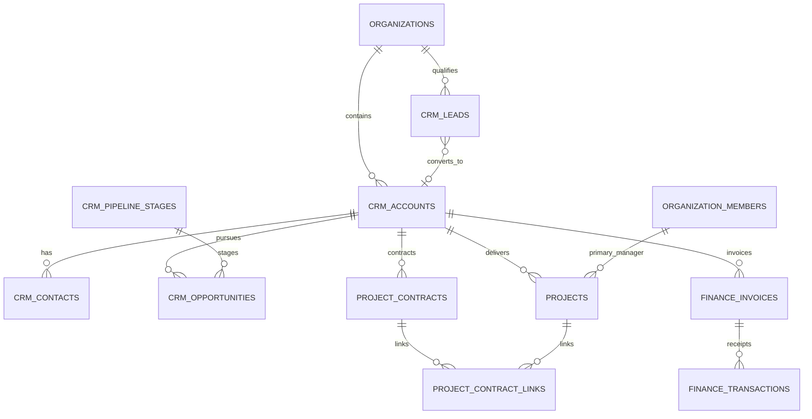

# Native enterprise CRM — architecture and delivery

## Baselines inspected before implementation

Rythm main `a504b63`: Next.js 15 App Router, React 19, TypeScript, Supabase SSR/Auth, PostgreSQL/RLS, direct Supabase clients (no ORM). The active organization context and organization_members are authoritative. Existing CRM accounts/contacts/stages/opportunities/activities, project_contracts, project_contract_links, project manager FK/history, finance invoices/lines/transactions, notifications, company_events and scoped crm_access_grants are reused. Platform billing customers are a separate domain. Existing project proposals are execution-planning artifacts, not sales quotations.

EspoCRM reference checkout `a3826adde17f050af353bd118cf1db623c4ae1b3` was read outside this repository. Inspected `composer.json`, LICENSE, Crm entityDefs for Account/Contact/Lead/Opportunity/Case, Tools/Lead/ConvertService.php, core PipelineStage metadata, Core/Duplicate/Finder.php, Core/Record/Service.php, Core/Acl/Table.php, Case scope metadata and Classes/Acl/Common/Pipeline/PipelineStageLinkChecker.php. Espo uses PHP services/ORM, metadata-driven entities, a JavaScript REST client, entity/field ACL, retained converted leads, relationship panels, duplicate checking, audited state changes and stage-to-pipeline integrity. Rythm implements these business concepts independently in its own stack. No Espo PHP, JavaScript, metadata, assets, dependencies or license text are incorporated. This is not a license compatibility approval to copy code.

Primary references:
- https://github.com/espocrm/espocrm/tree/a3826adde17f050af353bd118cf1db623c4ae1b3
- https://docs.espocrm.com/user-guide/sales-management/
- https://docs.espocrm.com/administration/roles-management/
- https://docs.espocrm.com/development/api/
- https://docs.espocrm.com/user-guide/quotes/
- https://www.espocrm.com/extensions/sales-pack/
- https://www.espocrm.com/extensions/advanced-pack/

Accounts, contacts, leads, opportunities, activities, cases, documents, ACL and metadata are in the inspected open-source core. Quotes, orders, invoices and payments are Sales Pack; reports, workflow builder and BPM are Advanced Pack. No general contract/project module was found in the inspected Crm core; preserve Rythm's native domains rather than treating advertising as evidence of free implementation.

## Gap matrix and implementation plan

| Feature | EspoCRM | Existing Rythm | Required action | Priority |
|---|---|---|---|---|
| Customers | Core | Implemented; needs improvement | Email/addresses/region, bounded custom properties, configurable duplicate guard | P0 |
| Contacts | Core | Implemented | Reuse multi-contact editor and primary contact serialization | P0 |
| Leads | Core, retained conversions | Missing separate entity | Assignment, qualification, follow-up, atomic conversion to new/existing customer + contact | P0 |
| Opportunities | Core | Requires improvement | Server stage validation, transition history, concurrency control | P0 |
| Pipeline | Core metadata | Stage table, no global board | Reuse stages; owner configuration, accessible board, per-currency totals | P0 |
| Contracts | Not found in inspected core | Implemented | Preserve explicit scope and customer links | P0 |
| Projects | Not found in inspected core | Implemented | Retain single manager FK, remediation, links | P0 |
| Financials | Sales Pack | Implemented ledger | Preserve deny-default RLS; audit sensitive application reads | P0 |
| Permissions | Core record/field ACL | Implemented scoped grants | Reuse; harden timeline writes and exports | P0 |
| Automation | Advanced Pack workflows/BPM | Existing company events | Redacted events, no new workflow runner or autonomous actions | P1 |
| Reporting | Advanced Pack | Missing sales dashboard | Authorized per-currency forecast and conversion counts | P1 |
| Import/export | Core | Missing CRM UI | Operational-only paged JSON import and CSV export | P1 |
| Support | Core cases | Missing customer case entity | Defer full support lifecycle; no fake tab | P2 |
| Quotes/orders | Sales Pack | Project proposals have different semantics | Defer commercial line-item/approval workflow | P2 |

Implement a functional lead → customer/contact → opportunity → pipeline/reporting slice on the existing customer/contract/project/ledger foundation. Then run the existing PostgreSQL fixture plus new migration/permission/state tests, UI interaction tests, typecheck, lint, build and browser checks. Remaining scope is recorded explicitly below; this increment is not the entire enterprise roadmap.

## Risks identified before changes

- Existing member-wide activity writes can fabricate financial-looking notes; constrain operational writes to customer.update and confidential writes to exact capability.
- Opportunity stage strings lack referential validation; canonical status/probability must be derived by the database, including direct API writes.
- Company events are broadly readable; never put names, amounts, descriptions, customer IDs or protected contract metadata into shared event payloads.
- Duplicate checking must serialize concurrent customer writes; browser preflight alone is insufficient. Preserve existing duplicates; block only conflicting new/changed identities.
- Operational customer custom properties must never hold financial secrets; sensitive attributes belong in protected domain tables.
- Base CRM production migration was applied in a previous task; this branch's migration must remain unapplied in production until approval. Legacy projects still require explicit owner-selected reconciliation.

## Delivery status

Implemented native increment:

- Customer profiles now include operational email, separate billing/business addresses, region and bounded scalar JSON custom properties. Existing fields and record IDs are retained. Customer 360 shows RLS-filtered relationship counts and existing contact/project/contract/finance/activity sections.
- Configurable tenant duplicate rules normalize name/email/registration. Database triggers serialize identity writes with a transaction advisory lock; failed duplicate conversions/imports roll back. Existing exact-name uniqueness is retained even if normalized matching is disabled. Historical duplicates are not merged or deleted.
- New `crm_leads` records support source, assignee, qualification, UTC follow-up dates and retained conversion links. Conversion requires qualification and creates a customer/contact or links to an existing permitted customer, reusing its matching contact. Retry is idempotent under a row lock. Converted records are immutable; no opportunity or financial action is silently created.
- Existing opportunity/stage tables power `/crm/pipeline`. Pointer drag/drop and keyboard stage forms call the same versioned server transition. DB triggers validate stage/tenant, derive status/default probability, require loss reasons, and restrict reopening closed deals to `finance.approve`. Customer-detail stage moves also use optimistic concurrency and never resubmit stale monetary values.
- Owner settings configure labels, sequence, default probability and additional open stages. This increment supports one configurable company pipeline, not multiple independently named pipelines. Future organizations receive their stage rows automatically.
- `/crm/reports` aggregates authorized opportunities with PostgreSQL numeric arithmetic, separated by original currency, with weighted open forecast, win rate and all-time lead conversion. Company financial dashboard visibility requires an explicit company finance.read grant; scoped deals remain available on the permitted customer/pipeline.
- Owner-only bounded JSON customer import (1–100, atomic) and paged operational CSV export (500/page, formula neutralization). Export excludes notes/custom properties, billing email, financial values, payment data and contract terms.
- Existing company_events receives empty-payload lifecycle signals; notifications contain generic lead assignment text. No workflow executor, outbound messaging or autonomous financial action is activated.
- Sensitive sales reporting RPC reads and customer/pipeline financial views record minimal access events. Existing audit triggers record changes. Data API RLS remains authoritative; these application access records are not a claim of universal SELECT auditing for every legacy PostgREST/table client.

## Data model

New persistent tables are only crm_leads and crm_preferences. A nullable primary_manager_user_id is retained only for explicitly flagged legacy remediation; new/reconciled projects still require exactly one active human manager. Existing confidential grants use user/agent principals and company/customer/contract/project scopes. The new sales API never instantiates a service-role client.

## Permission matrix

| Operation | Active member | Company owner | Explicit capability |
|---|---|---|---|
| Read operational customers/leads/stages | Existing company member behavior | Yes | customer.read can supplement within existing rules |
| Create lead/customer | No implicit write | Yes | customer.create at company scope |
| Update/convert lead | No implicit write | Yes | customer.update company; creating/linking customer additionally checked |
| Read opportunity/value/history | No implicit financial access | No implicit financial access | finance.read company or matching customer scope |
| Create/update opportunity | No implicit financial access | No implicit financial access | finance.create/update for that customer |
| Reopen closed opportunity | No | No implicit approval | finance.approve for that customer |
| Read contract terms/attachments | No | No implicit read | contract.read for exact or containing scope |
| Manage pipeline/duplicate rules | No | Yes | Owner administration |
| Operational import/export | No | Yes, caller RLS still applies | Owner + customer.create for import |
| Company financial dashboard | No | No implicit read | finance.read company |
| Primary project manager | Operational project access only | Existing operational rules | No automatic contract/finance grant |

Record-level grants and active-membership/revocation checks reuse the existing crm_can boundary. Monetary opportunity fields remain in a fully finance-protected row rather than a UI-only field mask. Existing project budget field restrictions/RPC and confidential document derivative quarantine are preserved. Role templates/team-level grant inheritance and arbitrary custom-field ACL configuration are not added in this increment.

## API and action contracts

All HTTP handlers use the signed-in active-organization context. Responses are private/no-store. Mutations require matching Origin and application/json, with a streaming 128 KB body cap. No generic token-based AI access is newly activated. UUIDs, fields, statuses and sizes are validated. PostgreSQL RLS also protects direct Data API access.

| Interface | Input | Behavior |
|---|---|---|
| GET /api/crm/leads?page=1 | 20 records/page | Operational leads for active tenant; 401 unauthenticated, 503 unavailable |
| POST /api/crm/leads | name, company_name, email, phone, source, status, owner_user_id, next_follow_up_at, qualification_notes | Explicit allowlist; tenant and conversion fields cannot be injected; 201/400/403 |
| POST /api/crm/opportunities/:id/stage | stage, version, lost_reason | Caller-bound lookup + versioned RPC; 404 invisible, 409 rejected/stale, 200 saved |
| GET /api/crm/customers/export?page=1 | 500 records/page | Owner-only operational CSV; X-Total-Count and X-Page-Size |
| RPC crm_convert_lead | p_lead_id, optional p_customer_id | Atomic qualified conversion; returns customer UUID; retained conversion fields are not directly writable |
| RPC crm_move_opportunity | p_opportunity_id, p_stage_code, p_version, optional p_lost_reason | Atomic version predicate and trigger validation |
| RPC crm_sales_report | p_organization_id, optional p_customer_id, p_owner_id | Caller-RLS numeric aggregates and minimal sensitive-read audit |
| RPC crm_customer_summary | organization/customer UUIDs | Counts only permitted related rows; null for invisible customer |
| RPC crm_import_customers | organization UUID, JSON array | Owner-only allowlisted atomic insert; 1–100 rows |
| RPC crm_log_sensitive_access | org/domain/resource type/UUID | Validates caller capability and tenant resource; audit contains no terms or amounts |
| Next server actions | lead edit/conversion; settings/stages/import; existing customer/contact/contract creation | Next origin/auth protections plus identical caller permissions and DB constraints |

The UI lead/customer selectors currently show the first 100 customers by name (clearly labeled); directory and board records are paginated. UTC follow-up dates are explicitly labeled. CSV paging uses stable ID ordering; a moving data set is not a snapshot export. The report is an all-time current-state snapshot, not a historical attribution/cohort analytics engine. Closed stage probabilities are fixed at Won=100/Lost=0; changing a stage default does not retroactively rewrite existing deal probabilities.

## Migration and release

`20261023104940_enterprise_customer_sales.sql` was created with Supabase CLI. It extends the already merged CRM migration, uses one transaction, preserves existing business records, seeds only missing complete tenant pipelines and marks the new stage FK NOT VALID for legacy investigation. Do not infer owners/classifications for old projects. Run both read-only release-preflight scripts, review historical stages/outcomes/duplicates and explicitly reconcile before accepting a complete rollout. Validate the new FK after remediation in staging.

This branch must not be merged or migrated in production without explicit approval. Preview code alone does not apply database migrations. Use an isolated staging database, apply base migrations then this migration, seed synthetic records, run suites and authenticated storage/tenant acceptance, then coordinate the approved migration and app release. Preserve existing confidential grants; owner status is not permission to auto-grant financial access. Roll back with a compatible forward fix; do not drop CRM/ledger tables or restore unrestricted financial policies.

## QA evidence and remaining work

Local baseline/shared CRM PostgreSQL suite passes; new PGlite migration cases exercise duplicate normalization/configuration, converted-lead column permissions, conversion qualification/retry/rollback/existing-customer linking, tenant denial, stage/outcome validation, version conflicts, loss reasons, closed-stage approval, confidential stage history, import atomicity/mass-assignment, event minimization and future-tenant seeding. UI/JSDOM tests cover actual stage selector/submit/drop events and read-only/failure states, input validation, custom properties, CSV injection and request Origin/body caps. HTTP handler tests invoke actual bundled route exports with isolated authentication/client adapters; these are not a real Supabase HTTP integration test.

Local Chromium install failed because the browser download was empty/truncated. Dedicated CI browser QA uses Chrome preinstalled in the documented Ubuntu 24.04 runner image (no browser download), builds the actual components and tests desktop (1440), tablet (768), mobile (390), horizontal overflow, selectors, loss reasons, rejection, drag/drop, read-only controls and console errors; screenshots are uploaded as CI artifacts. Its local fixture uses a simulated transition endpoint and is explicitly not signed-in staging end-to-end verification. Final CI results are recorded in the PR.

Verified CI browser result: `crm-browser` passed in [run 39945290949](https://github.com/rythm2237/Rythm-company-os/actions/runs/39945290949), including all three viewport sizes and zero browser console errors. Actual browser tests exposed ambiguous control labels and dragging from form controls; explicit accessible names and a separate drag handle resolve both. Desktop/tablet/mobile screenshots are in the run's `crm-browser-screenshots` artifact. Vercel preview build succeeded on earlier branch revisions; final-head status is recorded in the PR. A protected-preview request made through the connected Vercel access tool returned the application's sign-in page (HTTP 200), confirming auth gating, not authenticated CRM acceptance.

Dependency audit was run against both baseline main `a504b63` and this branch: both report the same 13 findings (10 high, 3 critical) in the same existing packages, including Next, jspdf, xlsx, sharp and transitive tooling. Neither added test dependency introduces a new finding in this comparison. These are unresolved baseline risks; no broad dependency upgrades or automatic `audit fix` are included in the CRM change. This finding prevents claiming an unqualified production security certification.

| Requested business scenario | Evidence |
|---|---|
| Customer + multiple contacts | Existing real PostgreSQL CRM suite; new profile/duplicate/converted contact cases |
| Create and advance opportunity | Real PostgreSQL stage/version/authorization tests; browser selectors and drag/drop |
| Customer-linked contract | Existing real PostgreSQL contract tenant/approval tests retained |
| Customer-linked project | Existing real PostgreSQL relationship tests retained |
| Exactly one manager / same manager on multiple projects | Existing DB constraints/history/reconciliation tests and multi-project manager case |
| Denied / allowed financial access | Real authenticated-role RLS, scope, revocation and inactive membership tests; new report/summary/anonymous cases |
| Existing project and contract compatibility | Shared CRM suite, Project OS/supervisor, security-definer, commercial payment and 11 project-completion regressions |
| Permission-filtered Customer 360 | Caller-RLS summary tests; UI rendering/type/build checks; signed-in staging UI acceptance pending |

Still pending: full sales quotation/order/approval/PDF lifecycle, support case/SLA lifecycle, customer relationship graph, multiple pipelines, typed custom-field schema/admin builder, historical sales cohorts, renewal/overdue/inactivity automation scheduling, dedicated commercial document/communication search and contact import/export. Existing contract/project/ledger flows are preserved but new staging browser acceptance against actual Supabase and private Storage remains required. No claim that the entire requested enterprise lifecycle is production-ready is made by this increment.

## Connected records activation — 23 October 2026

`20261023123537_crm_connected_records.sql` extends the existing domain; it creates no competing customer, contract or project tables. Apply it after `20261023104940_enterprise_customer_sales.sql`.

Customer profile is the canonical live identity for project workspaces and new invoice drafts. Customer 360 reads projects by `projects.customer_id`, so projects created from either entry point appear in the same lists. Project forms preserve customer/contract context and filter contracts by the selected customer. The caller-bound, invoker RPC `crm_create_linked_project(organization_id, project, contract_id?, new_contract?)` atomically creates the project and its existing/new contract link. Explicit capability checks, active-human manager enforcement, tenant RLS and same-customer constraints still apply. A failed contract creation rolls back the project. Optional file/resource uploads remain separate operations.

Finance selectors use the same customer/project/contract relationships and reject mismatched pairs at the database layer. Invoice customer name/email are refreshed from the canonical profile on draft edits and issuance. Issued invoices retain historical identity when the customer changes. Payments must match their invoice's customer, project and contract. Customer-filtered invoice/payment registers retain the existing Finance Center company-finance permission boundary. Customer-scoped readers can use Customer 360 under existing RLS.

Project-uploaded documents derive their customer from the project. Contract-category attachments also derive the contract when exactly one is linked; ambiguous multiple-contract cases are never guessed. Protected download routes enforce caller RLS before service storage access and audit confidential downloads. Customer Documents lists authorized project/contract attachments. Operational project metadata propagates on an authorized customer reassignment; legacy projects remain unassigned until explicit reconciliation.

Contract identity extraction uses independently licensed `unpdf` (MIT) and `fflate` (MIT), without copying EspoCRM code. Authorized users with contract read/update plus customer update can extract candidates from a contract attachment: text-based PDF (up to 30 pages), DOCX or UTF-8 TXT (10 MB maximum). The deterministic parser accepts explicitly customer-labelled English, Persian and Hungarian identity lines; it does not infer arbitrary prose, perform OCR, or extract commercial terms. There are no AI calls, shared document ingestion or external communications. Suggestions/provenance remain in the protected contract row. Review shows current/proposed values, selects only empty fields by default, and requires explicit field selection. The invoker `crm_apply_contract_profile(contract_id, fields, expected_customer_updated_at, expected_suggestion_hash)` checks permissions and locks records, rejects stale profile/proposal reviews, applies selected fields only, and clears the proposal transactionally. Existing audit triggers record changes without copying private terms.

### Validation for this increment

- `npm run test:enterprise-crm`: isolated PostgreSQL-compatible PGlite migration/RLS/integrity suite, including atomic project/contract rollback, canonical invoice identity, immutable issued snapshot across profile updates, payment/document attribution, selected-field approval, stale reviews, tenant and permission denials.
- `npm run test:crm-connected`: actual PDF/DOCX/TXT parser cases, Persian labels, supplier exclusion, size limits, live React dependent selectors and invoice autofill.
- `npm run test:crm-sales`: existing UI/API regression coverage.
- `npm run typecheck`, `npm run lint`, `npm run build`: compilation and existing regression checks; lint retains pre-existing warnings.
- CI browser suite includes real shared selectors/autofill at desktop/tablet/mobile widths alongside existing pipeline QA. It uses isolated fixtures and a simulated stage endpoint, not a signed-in production account.

No production test records are inserted. Existing legacy assignments, confidential grants and issued financial documents are not guessed or broadly backfilled. Proposal/order/support/SLA features listed as deferred earlier remain deferred; this increment connects implemented records rather than claiming those missing modules exist.
