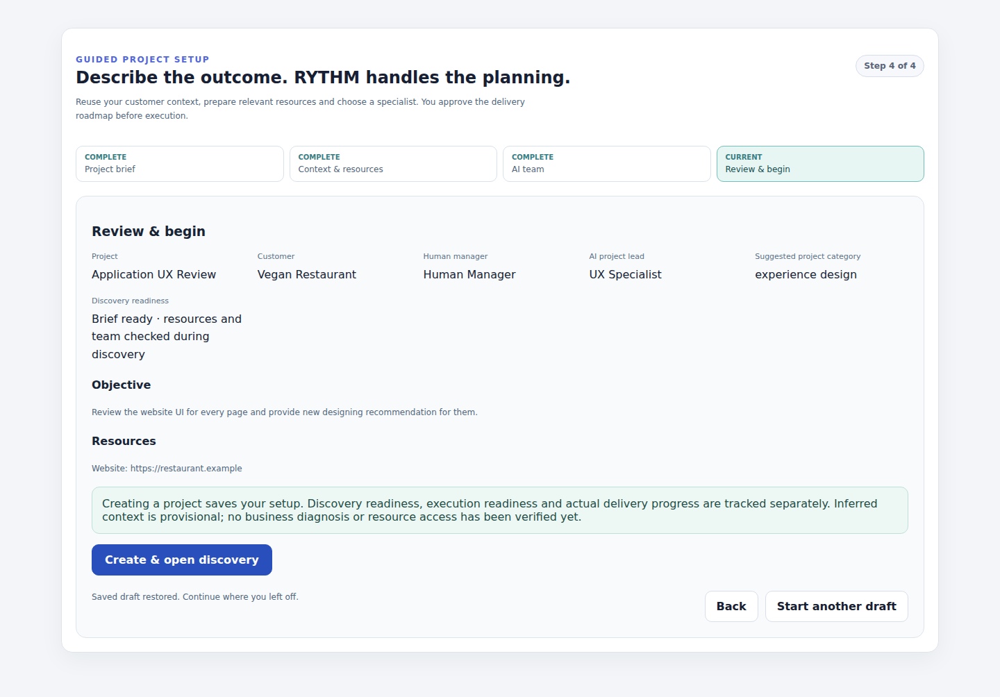
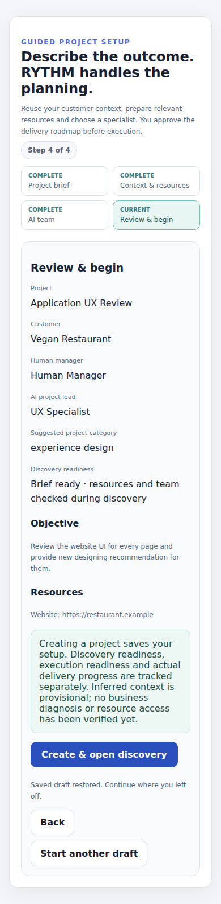
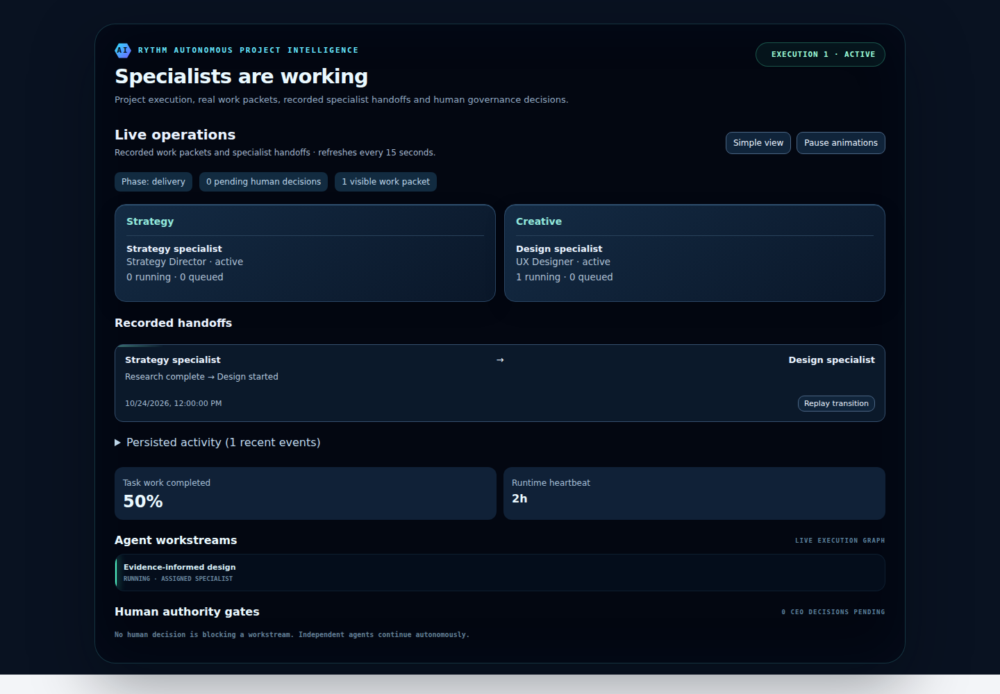
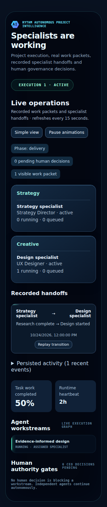

# Universal Project OS implementation and release evidence

Date: 2026-10-24. This document records implemented behavior and its verification boundary; it is not a claim of production completion.

## Delivery status

| Area | Status | Evidence / boundary |
| --- | --- | --- |
| Shared business-context/discovery contracts | Implemented; isolated tests passed | `project-intelligence.ts`, source-attributed context, hypotheses, depth and plan kind |
| Naming and guided setup | Implemented; actual server-action and component browser tests passed | Four steps, editable title, Gateway fallback, CRM reuse, resources, manager, auto/manual lead |
| Draft persistence | Implemented in same browser | Org/user/customer-scoped versioned local storage; cross-device synchronization not implemented |
| CRM/knowledge reuse and human correction | Implemented | Caller-RLS operational allowlists; customer-scoped approved corrections; current project corrections override inherited context |
| Minimal questions | Implemented | 0–3 initial essential target, mandatory exceptions, prior-answer suppression and deferred task input dependencies |
| Capacity-aware assignments | Implemented; real PostgreSQL tests passed | Eligibility/scoring, service-only atomic reservation, one active lead, queue/concurrency accounting |
| Agent skills | Reused/extended as capability profiles | Listed skills remain declared. Independently verified work history is used when available. New per-skill certification is not implemented |
| Diagnosis and problem-definition review | Implemented; tests passed | Provisional hypotheses and scope; approval records explicit problem definition |
| Discovery/Delivery plans | Implemented at generation/review boundary | Existing roadmap versions and approval are reused. No automatic end-to-end promotion of completed discovery findings to a validated Delivery Roadmap is claimed |
| Specialist collaboration | Existing meeting infrastructure retained | Domain methods/lead and assigned specialists inform planning. Automatic independent multi-specialist deliberation before every material roadmap is not newly implemented |
| Canonical next action and overview | Implemented; tests passed | Common server projection, active legacy preservation, holds, review, verification, team recovery |
| Live operations | Implemented; component browser tests passed | Real persisted cross-agent dependency handoffs; deterministic IDs, stable cursor replay, reconnect, pause/reduced-motion/simple view |
| Task-specific missing input/resource holds | Implemented | Preparation can proceed; page inspection cannot claim unseen evidence; staged clarification dependencies |
| External business research | Not newly implemented | Existing permitted connectors/resources retained; no autonomous public web crawler added |
| Protected finance/contracts | Existing authorization retained; regressions passed | No protected commercial terms enter shared analysis; existing tenant/RLS CRM suite passes |
| Hosted staging validation | Blocked | Restore of `rythm-phase3-staging` rejected: account has two active free projects, its maximum |
| Production migration / merge / deployment | Not performed | Release gate requires hosted staging validation; production remains on audited main |

## Tests and evidence

- TypeScript check passed.
- ESLint passed with existing non-blocking repository warnings; targeted changed-file lint has no errors.
- Production `npm run build` passed, including existing prebuild regression suites and completion checks. Re-run after final integrated changes before release.
- New `test:universal-project` covers source provenance, vegan audience hypotheses, question priority/budget, diagnosis uncertainty, correction allowlists, roadmap dependency cycles, stale approval replay, fallback naming, resource URL validation, actual setup server action retries, next-action states, assignment/tenant permissions/capacity, scheduler leases and event replay.
- Existing enterprise CRM PostgreSQL/UI suite passed: tenant isolation, explicit commercial permissions, manager/customer relationships, atomic linked creation/rollback, connected invoice/payment attribution and protected attachment/context rules.
- Existing project OS/supervisor, completion and security-definer checks passed during implementation.
- Real Chromium component tests passed: setup at 1440×1000, 768×1024, 390×844; live operations additionally at 320px. These use actual React components and isolated synthetic API responses. They do **not** prove authenticated hosted UI → real API → hosted database → actual AI → scheduler behavior.
- PostgreSQL tests use PGlite with actual migrations and representative schema. Scheduler tests exercise sequential workers against occupied slots. A simultaneous multi-connection race has not been tested.

## Acceptance scenario matrix

| Scenario | Verified locally | Hosted end-to-end |
| --- | --- | --- |
| A: Vegan restaurant | Hospitality inference, possible audience uncertainty, hypothesis/discovery contracts, limited questions | Pending staging and actual configured specialist/AI execution |
| B: Software redesign | Technical capability/resource profile, diagnosis and roadmap graph guards | Pending staging, repository retrieval and actual specialist execution |
| C: Simple internal report | Lightweight discovery/direct delivery classification and concise intake | Pending staging |
| D: Missing website | Missing resource question and task-specific hold; no fabricated page review | Pending staging and evidence ingestion |
| E: Capacity exhausted | Suitable alternative/blocked outcome, queues, lease concurrency and atomic reservation | Simultaneous-worker staging test pending |
| F: Legacy project | Guidance preserves active execution; repeat/stale roadmap approval guards | Real existing-project read-only regression pending |
| G: Two tenants | SQL permission/tenant tests and RLS-scoped context retrieval | Hosted multi-user exercise pending |
| H: Real handoff | Persisted event writer, stable identity/cursor/dedup, actual UI replay/reconnect | Actual hosted downstream task transition pending |

## Browser screenshots

All screenshots below are from the real component tests with explicitly synthetic test records.

## Security audit baseline

Production advisory read was performed before new migrations. It reported pre-existing INFO notices for 33 RLS-enabled tables without client policies, two mutable function search paths, public and authenticated callable SECURITY DEFINER notices (including intentionally public booking APIs), and disabled leaked-password protection. These are not a clean-security certification and were not changed as unrelated scope. Review each finding in its own authorization context before remediation; do not blindly revoke intentional public endpoints. New migration permission tests deny authenticated/anonymous callers of the reservation and claim RPCs.

Supabase reference: https://supabase.com/docs/guides/database/database-linter

## Next release gate

Make a staging database available without modifying the user's unrelated projects. Then inspect its schema, apply both migrations, run advisors and representative concurrent/tenant/legacy tests, configure a Preview deployment against that staging database, and complete authenticated acceptance flows. Merge only after those checks and CI pass. No production customer test records were created or modified during this implementation.
